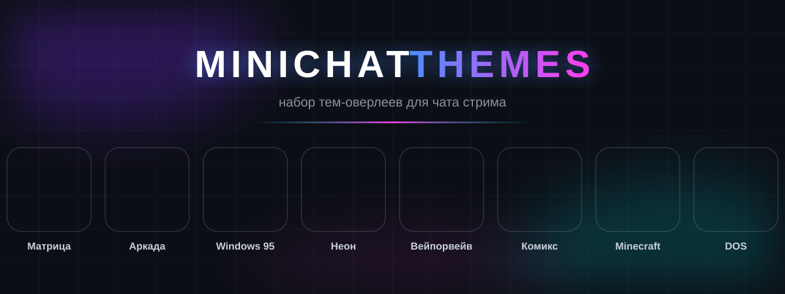
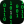
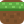

<div align="center">



**Chat overlay themes for [Minichat](https://minichat.pro)** — from a Matrix-style terminal to split-flap airport boards.

*Every theme is a self-contained folder: drop it into `Themes` → add a Browser Source in OBS → go live.*


[🇷🇺 Русская версия](README.md) · **English**

</div>

---

## 🎨 Themes

| | Theme | Vibe | Features |
|---|---|---|---|
|  | **Matrix** | green terminal | typewriter effect (typed.js), animated digital rain, glowing text, console cursor |
|  | **Arcade** | 80s arcade | Press Start 2P, 1UP / HI-SCORE bar, blinking `INSERT COIN`, chunky pixel frames |
|  | **Windows 95** | retro PC | real beveled window, custom title bar, tray clock, instant animations |
|  | **Neon** | night city | card styles: *glass / neon border / minimal*, gradient names, glow slider |
|  | **Vaporwave** | ａｅｓｔｈｅｔｉｃｓ | perspective neon grid, retro sun, pink-cyan gradients |
|  | **Comic** | POW! | speech bubbles with tails, adjustable color/outline, halftone dots, wavy strikethrough |
|  | **Minecraft** | vanilla chat | Monocraft font with Cyrillic, translucent rows, pixel text shadow |
|  | **CRT TV** | teletext | scanlines, phosphor flicker, screen curve, "CH 01" OSD with clock, static noise on donations |
|  | **Split-flap** | airport board | flap-style rows (flipInX), board header with clock, tile seams |
|  | **Space Mission** | NASA telemetry | canvas star field with meteors, nebula, HUD frame with "T+" mission timer |
|  | **Cyberpunk** | Night City | RGB glitch title, cut-corner cards, scanline sweep, skewed rows |
|  | **Halloween** | 🎃 spooky season | canvas bats on the background, mystic fog, Neucha font, pumpkin live events |
|  | **New Year** | 🎄 festive | blinking garland, snow on by default, canvas fireworks, "Happy New Year!" header, Yeseva One font |
|  | **DOS** | classic | the original theme — format reference (FixedSys Excelsior, typed.js) |

> Every theme ships **30+ settings** right in Minichat: corner rounding, text shadows
> (5 styles + color), translucent card backdrop, accent color, message timestamps,
> avatar size/shape, animation duration, letter spacing, message limits, entry/exit
> effects and more.

## ✨ ThemeFX effects (v1.2)

A shared effects engine built into every theme:

- 💥 **Donation glitch** — RGB-split shake on highlighted rows
- 🎉 **Confetti** — canvas particle burst on every donation
- 🔊 **Sound** — donations and events synthesized with WebAudio (no audio files)
- 🌈 **Name hash color** — deterministic per-nickname color, like Twitch
- ❄️ **Snowfall** — canvas background for any theme
- 🦇 **Bats** and 🎆 **fireworks** — seasonal canvas effects
- 🎵 **4 sound schemes** — Classic, Retro (8-bit), Bubbles, Crystal (configurable per theme)
- Plus theme-specific: stars & meteors in Space, static noise in CRT, glitch title in Cyberpunk

## ⬇️ Download

Grab ready-made ZIP archives from [**Releases**](https://github.com/cherdakmd/minichat_THEMES/releases/latest) —
a single theme (`Minichat-Theme-Neon.zip`) or everything at once (`Minichat-THEMES-all.zip`).
Releases are built automatically by GitHub Actions.

## 🚀 Install

1. Download a theme ZIP and unpack it.
2. Copy the theme folder into the **`Themes`** directory of Minichat.
3. Restart Minichat → pick the theme in the overlay settings → add a Browser Source in OBS/Streamlabs.

## 🖥 Live preview & theme builder

The repo includes a gallery with a fake chat feed **and a live theme editor**:

```bash
git clone https://github.com/cherdakmd/minichat_THEMES.git
cd minichat_THEMES
python3 preview/serve.py
# → http://localhost:8123/preview/index.html
```

- Tweak any setting (sliders, colors, toggles) and see changes **instantly**;
- **🎲 Random** — randomize the style in one click;
- **⬇️ manifest.json** — download your tuned config and drop it into the theme folder;
- **🔗 Preset link** — settings are encoded in the URL, easy to share.

> `preview/stubs/` are **preview-only** mocks. Minichat ships its own `Additions/*` files.

## 🧩 Theme format

```
ThemeName/
├── manifest.json        # name, icon, settings shown in Minichat UI
├── Localization/en.lng  # English labels
├── index.html           # Vue 3 overlay template
├── style.css            # styles
├── icon.svg             # icon in the theme list
├── template.js          # theme logic (mixin: computed, effects)
├── effects.js / .css    # shared ThemeFX engine
└── fonts/               # fonts + fonts.css (@font-face)
```

Full spec — **[docs/THEME_FORMAT.md](docs/THEME_FORMAT.md)** (in Russian).

## 🤝 Contributing

Found a bug or want to add a theme? Open an issue or PR. Run `python3 preview/serve.py`
before submitting and keep the manifest structure intact. CI validates every theme
and builds release archives automatically.

---

<div align="center">

**MIT** © cherdakmd · made with ☕ and 💜

</div>
