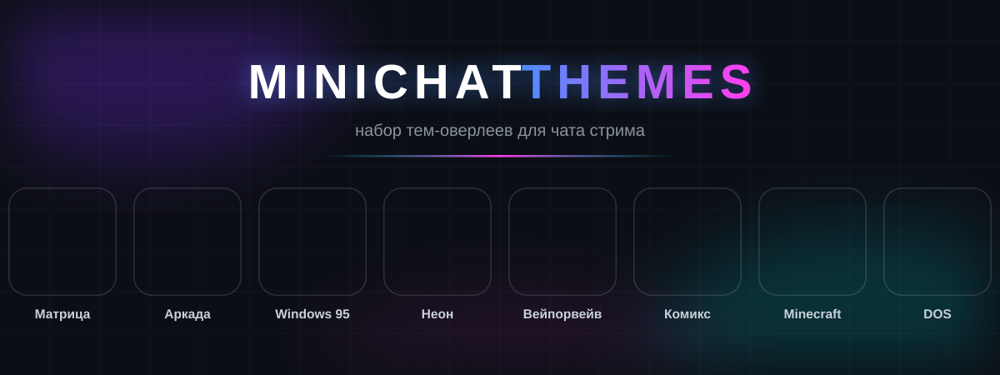
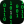
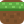

<div align="center">



**Темы-оверлеи для чата программы [Minichat](https://minichat.pro)** — от терминала «Матрицы» до вейпорвейва.

*Каждая тема — самодостаточная папка: скопировал в `Themes` → включил в OBS → стримишь.*


</div>

---

## 🎨 Темы

| | Тема | Вайб | Фишки |
|---|---|---|---|
|  | **Матрица** | зелёный терминал | эффект печатной машинки (typed.js), анимированный «цифровой дождь» на фоне, свечение текста, курсор консоли |
|  | **Аркада** | игровой автомат 80-х | шрифт Press Start 2P, score-бар «1UP / HI-SCORE», мигающий `INSERT COIN`, жёсткие пиксельные рамки |
|  | **Windows 95** | ретро-ПК | настоящее окно с бевелями, настраиваемый заголовок, часы в трее, мгновенные эффекты |
|  | **Неон** | ночной город | карточки на выбор: *стекло / неоновая рамка / минимализм*, градиентные имена, ползунок свечения |
|  | **Вейпорвейв** | ƒａｅｓｔｈｅｔｉｃｓ | перспективная неоновая сетка, ретро-солнце, розово-циановые градиенты |
|  | **Комикс** | POW! | речевые пузыри с хвостиком, настраиваемые цвет и толщина обводки, точки-растр, волнистое зачёркивание |
|  | **Minecraft** | ванильный чат | шрифт Monocraft с кириллицей, полупрозрачные строки, пиксельная тень текста |
|  | **DOS** | классика | оригинальная тема — эталон формата (FixedSys Excelsior, typed.js) |

> У каждой темы **30+ настроек** прямо в Minichat: скругление краёв, тень текста
> (5 видов + цвет), подложка с прозрачностью, акцентный цвет, время сообщений,
> форма и размер аватаров, скорость анимаций, межбуквенный интервал, лимит и
> время жизни сообщений, эффекты появления/исчезновения — всё на русском.

## ⬇️ Скачать

Готовые ZIP-архивы — в [**Releases**](https://github.com/cherdakmd/minichat_THEMES/releases/latest):
отдельная тема (`Minichat-Theme-Neon.zip`) или общий архив со всеми темами (`Minichat-THEMES-all.zip`).
Прямые ссылки — в описании релиза, тот же набор лежит в папке [`release/`](release/).

## 🚀 Установка

1. Скачай тему из [Releases](https://github.com/cherdakmd/minichat_THEMES/releases/latest) или забери папку прямо из репозитория.
2. Скопируй её в каталог **`Themes`** программы Minichat.
3. Перезапусти Minichat → выбери тему в настройках оверлея → добавь Browser Source в OBS/Streamlabs.

Никаких зависимостей ставить не нужно: шрифты и всё остальное лежат внутри темы.

## 🖥 Живое превью

В репозитории есть страница-галерея с имитацией чата — демо-лента, донаты,
Live-события, пауза/скорость и смена фона (тёмный / «игра» / прозрачность) для проверки читаемости:

```bash
git clone https://github.com/cherdakmd/minichat_THEMES.git
cd minichat_THEMES
python3 preview/serve.py
# → http://localhost:8123/preview/index.html
```

> `preview/stubs/` — это заглушки **только для превью** (имитация сообщений чата).
> В самом Minichat используются его собственные `Additions/*` — копировать заглушки никуда не нужно.

## 🧩 Формат темы

Хочешь сделать свою тему? Структура простая:

```
ИмяТемы/
├── manifest.json        # название, иконка, свойства (настройки в UI Minichat)
├── Localization/en.lng  # английские подписи настроек
├── index.html           # Vue 3 шаблон оверлея
├── style.css            # стили
├── icon.svg             # иконка в списке тем
├── template.js          # логика темы (mixin: computed, эффекты)
└── fonts/               # шрифты + fonts.css
```

Полная документация — **[docs/THEME_FORMAT.md](docs/THEME_FORMAT.md)**:
контракт `widget.js`, все типы свойств манифеста, локализация, подключение шрифтов и чек-лист новой темы.

## ✍️ Шрифты (все свободные)

| Шрифт | Тема | Лицензия |
|---|---|---|
| FixedSys Excelsior (FSEX300) | DOS, Матрица | свободный шрифт |
| Press Start 2P | Аркада | SIL OFL (@fontsource) |
| W95FA + Pixelify Sans | Windows 95 | SIL OFL |
| Russo One | Неон | SIL OFL (@fontsource) |
| Audiowide + Play | Вейпорвейв | SIL OFL (@fontsource) |
| Balsamiq Sans | Комикс | SIL OFL (@fontsource) |
| Monocraft | Minecraft | SIL OFL ([Monocraft](https://github.com/IdreesInc/Monocraft)) |

Шрифты подключены через `@font-face` c `unicode-range` — кириллица поддерживается
(кроме W95FA: для неё латиница — W95FA, кириллица — Pixelify Sans).

## 🤝 Контрибуция

Нашёл баг или хочешь добавить тему — заводи issue или PR.
Перед PR проверь тему локально (`python3 preview/serve.py`) и сохрани структуру манифеста — см. [docs/THEME_FORMAT.md](docs/THEME_FORMAT.md).

---

<div align="center">

**MIT** © cherdakmd · сделано с ☕ и 💜

↑ звезда репозиторию, если темы пригодились

</div>
